# E54 VPW monitoring bench evidence — October 29, 2026

Three ordinary E54/LB7 reads completed with matching observed transfer data and no repeated addressed read requests: with the OBDX Pro GT attached but its network OFF, attached in LISTEN ONLY, and physically unplugged from OBD. The twelve scope photographs below show no obvious gross waveform deterioration between those conditions. Rising-edge overshoot and rounded falling tails remain visible with the GT absent.

**The simultaneous all-source GT capture was not lossless.** It missed three short acknowledgments present in the EFILive reference trace, despite capturing all 128 data blocks. These results do not prove complete electrical noninterference or qualify AL5 programming, interrupted-flash recovery, or monitoring during a flash. **Live AL5 writes remain disabled.**

This is a documentation and photo publication for AL5 capture research. The controller tested was an **E54 ECM**, not an AL5 TCM. No writer, firmware, or capture-tool implementation is changed by this update.

[Machine-readable results, evidence hashes and photo manifest](E54_VPW_MONITORING_20261029.json)

## Setup and method

- Isolated E54/LB7 bench ECM; reported OS `15189044`.
- EFILive AutoCal V2 performed ordinary high-speed E54 reads. No flash/erase operation was run in this experiment. The vendor read sequence includes its RAM read loader.
- OBDX Pro GT hardware `1.0.0.0`, firmware `1.0.2.0`; the capture tool used adapter-local commands and fixed 4× LISTEN ONLY with the experimental all-source filter configuration. The recorded outgoing guard reported zero violations.
- FNIRSI 2C53P, CH1 at **5 V/div**, **×10** probe menu, **DC** coupling; photos at **20 µs/div** and **100 µs/div**. Physical attenuation, probe compensation and calibration were not independently verified.
- For the disconnected control, the user unplugged only the GT OBD leg while retaining AutoCal, the splitter, scope probe and scope settings. Physical setup and photo-to-run association are user reported; adapter GET records support the attached OFF/LISTEN states.

Offline analysis compared a defined HTX message window strictly after A1 through the final E54 data response, excluding known local wrapper-query records. Wrapper direction remains an inference; the HTX is an application reference, not an independently complete recording of the physical bus. For GT comparison, only the final physical VPW CRC byte was removed from each frame. Extra frames were retained in the strict comparison.

The fixed-rate capture does not establish continuity through 1× startup, the change to 4×, or return to 1×. UI elapsed times and addressed-transfer times measure different windows.

## Read results

- **GT attached, network OFF — read 6:** UI elapsed **2:00**; first addressed request to final data response **113.958 s**.
- **GT attached, LISTEN ONLY — read 7:** UI elapsed **1:59**; addressed transfer **113.947 s**.
- **GT OBD unplugged — read 8:** UI elapsed **2:01**; addressed transfer **115.004 s**.

All three reference traces have the same ordered **392-message** selected window: **132 host-request candidates** and **260 ECM-response candidates**. Each contains **128 unique addressed requests**, **128 unique data blocks**, valid block checksums, no conflicting data and **zero repeated addressed requests**. EFILive reported all six segment checksums valid in each read: `7288`, `BE72`, `6D21`, `A3D3`, `9F33`, `16FB`.

The observed range is `[0x000000, 0x07FFFE)`: **524,286 bytes** with identical SHA-256 in all three runs:

```text
a53bef772ac8f176296c5923fd3f93ca862ab5148cff292b7fb63eee37dd58ed
```

The final **two bytes** of a 512 KiB image are unobserved. They were not filled from another image, and this digest is not a full-image digest.

Each HTX contains seven literal `Timed Out` records, all outside the selected transfer window. This is not a claim that every stage of each session was error-free. One run per compared condition and approximately one-second elapsed variation do not establish a causal or statistically significant timing effect.

## GT capture completeness

The scoped LISTEN capture contains **393 network frames**, all with valid physical VPW CRCs. All **132 reference host requests** are present in order, and all **128 long data blocks** are present with valid additive checksums and matching observed data. The strict full-stream comparison nevertheless **fails**:

- Missing once: `6C F0 10 76 80 78`, a read-loader acknowledgment.
- Missing twice: `6D F0 10 75 01 54`, associated by order with the requests at `0x02D000` and `0x068000`. The acknowledgment itself does not contain those addresses.
- Four extra messages, once each: `6C FE F1 3F`, `8C FE F0 3F`, `6C 10 F0 3F`, `6C 10 F0 3C 55`.

The observed header-source counts are `F0: 135`, `10: 257`, `F1: 1`. Header addresses do not establish which physical device transmitted a message. Extras cannot compensate for missing acknowledgments or be silently removed to claim a pass.

The serial-delivery audit accounts for all **532,830 logged RX bytes**, mapping them to **467 DVI frames**, including the **393 network frames**, with **zero unaccounted bytes**. The missing acknowledgments are already absent at the recorded `serial_rx` boundary. This rules out discarding a complete recorded DVI frame during strict replay; it does not locate the loss among the bus, adapter, USB/driver or host stages before logging.

All nine observable adapter settings matched their initial GET values after cleanup, and network OFF was verified. Hidden setting state remains unknown. The capture-tool command audit and sampled bus photographs do not prove the absence of every unintended electrical transmission.

## Scope observations and limits

The original photographs show high plateaus about **1.4–1.6 vertical divisions** above low in all three conditions, roughly **7–8 V** if the physical probe matches the ×10 menu setting. Low levels return near the displayed reference. Leading overshoot and rounded falling edges appear in all three conditions, including the physically disconnected GT control.

The presence of those peaks and tails therefore cannot, by itself, be attributed to GT listening. A smaller GT contribution is not excluded. No obvious gross amplitude collapse, clipping, stuck level or persistent level shift is visible in these short photographed windows.

Different packets and bit patterns, camera perspective, focus, exposure and scope rendering prevent reliable small voltage or edge-time comparisons. These are camera photographs of the scope display, not exported waveform samples or cursor measurements. Acquisition times and packet identities are unknown. The windows cannot exclude rare disturbances elsewhere, and a shared bus-voltage trace cannot identify the physical transmitter.

The supported conclusion is **no observed read-data or retry degradation, and no obvious gross waveform deterioration, in these isolated-bench E54 high-speed read comparisons**. Complete electrical noninterference, lossless capture and speed-transition coverage remain unproven.

## Original scope photographs

The twelve JPEGs are copied unchanged from the retained user-supplied originals. Their byte counts and SHA-256 values are in the [manifest](E54_VPW_MONITORING_20261029.json). Screen labels such as `4.bmp` are scope image labels, not CTZ read numbers. The earlier accidental redisplay of baseline images as LISTEN images is excluded.

<details>
<summary>GT attached, network OFF — four baseline photographs</summary>

20 µs/div, screen `4.bmp`:

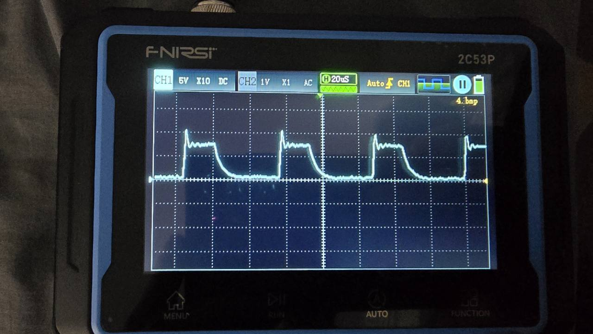

20 µs/div, screen `5.bmp`:

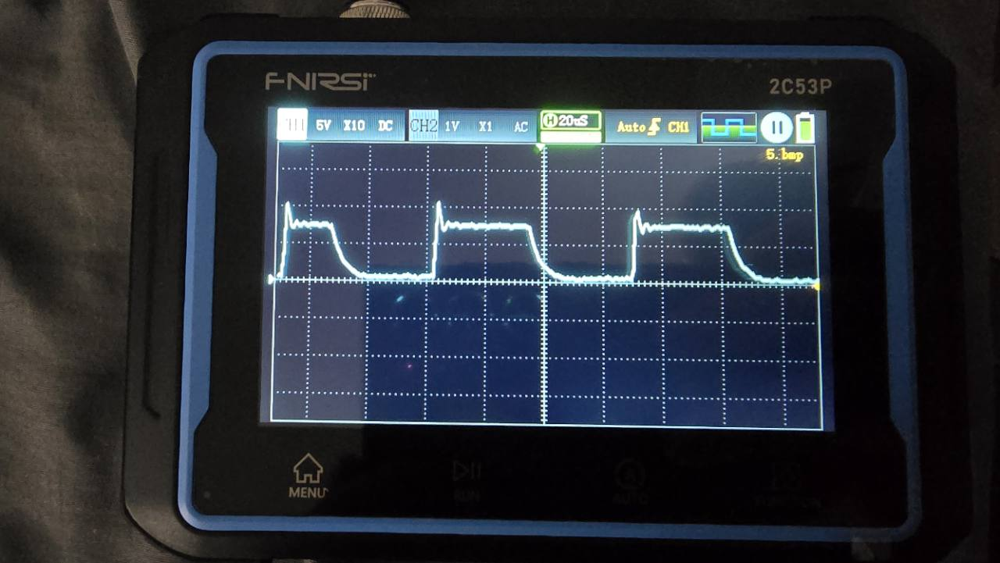

100 µs/div, screen `6.bmp`:

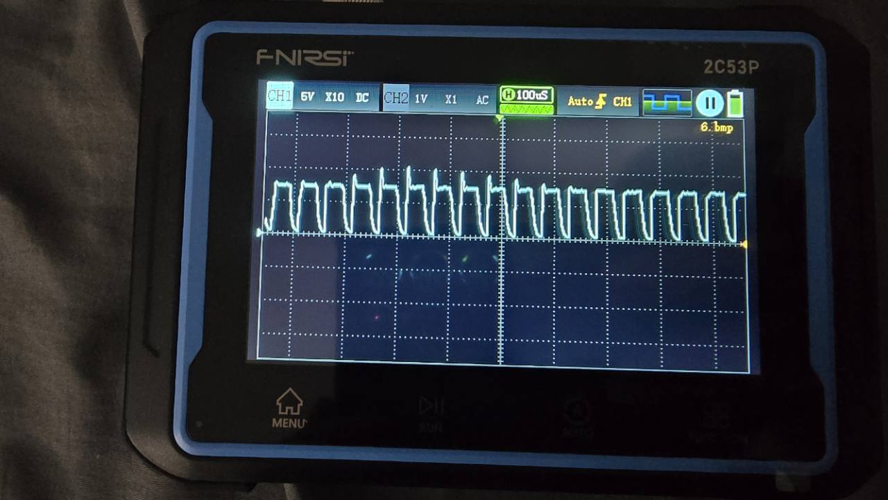

100 µs/div, screen `7.bmp`:

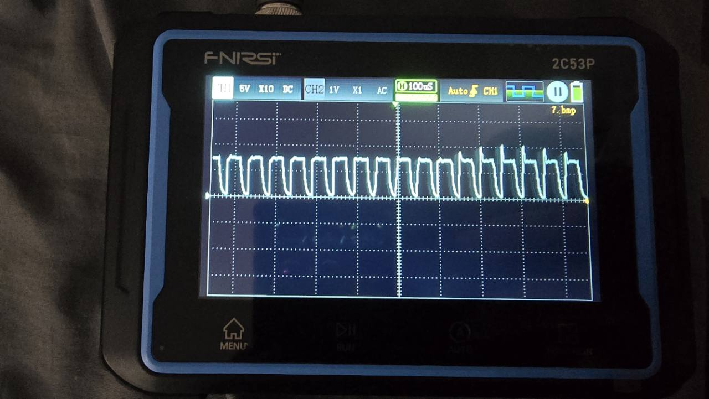

</details>

<details>
<summary>GT attached, LISTEN ONLY — four monitoring photographs</summary>

20 µs/div, screen `16.bmp`:

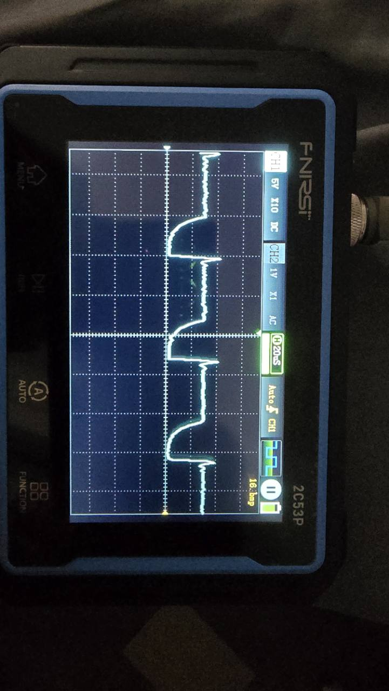

20 µs/div, screen `17.bmp`:

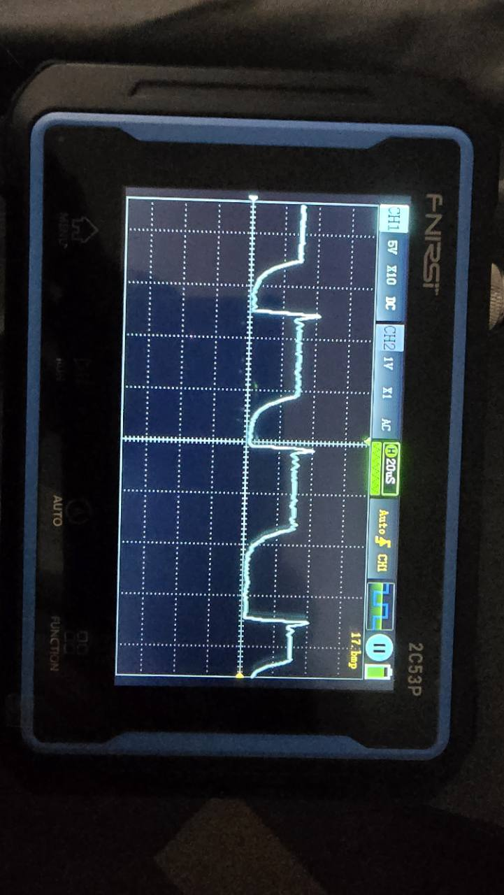

100 µs/div, screen `18.bmp`:

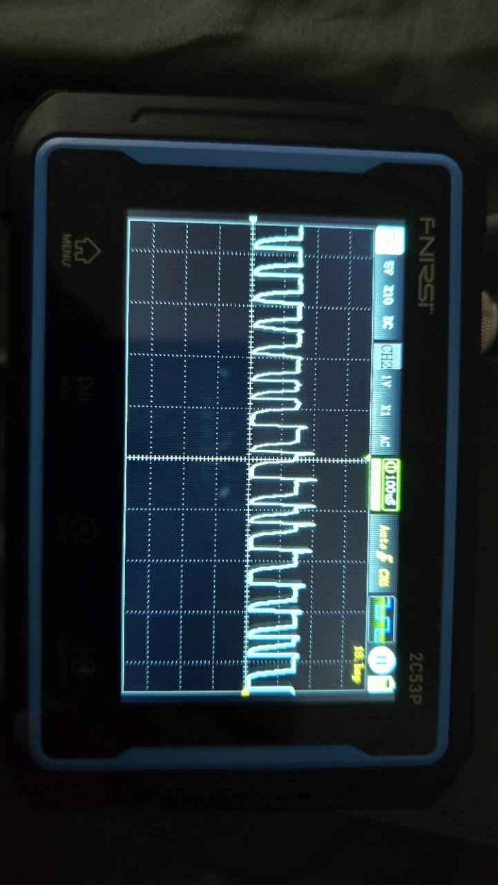

100 µs/div, screen `19.bmp`:

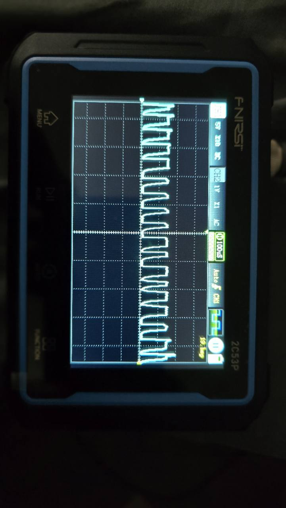

</details>

<details>
<summary>GT OBD unplugged — four physical-disconnection controls</summary>

20 µs/div, screen `24.bmp`:

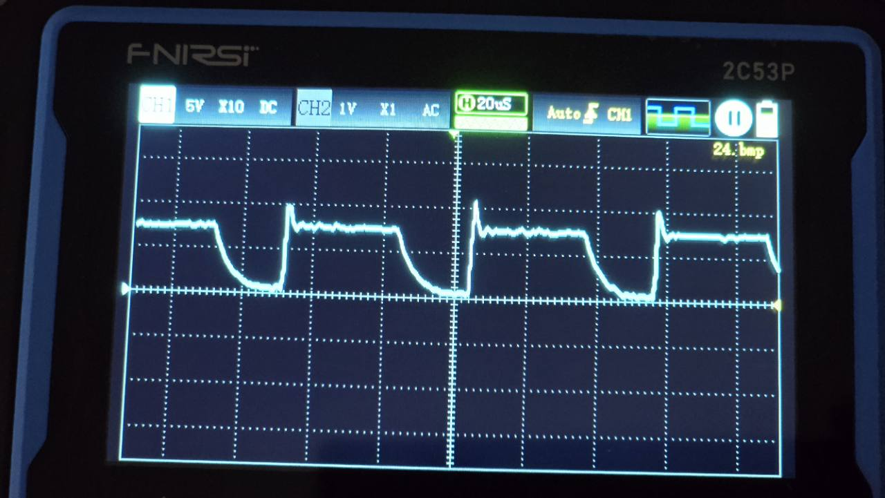

20 µs/div, screen `26.bmp`:

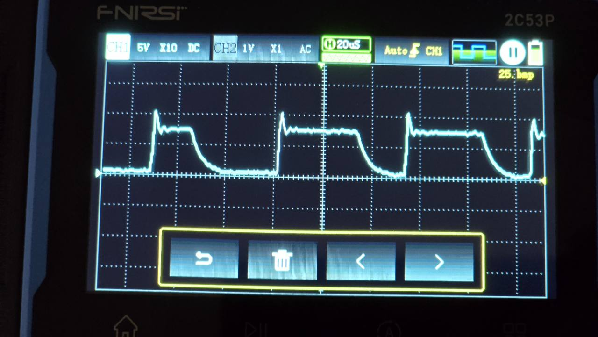

100 µs/div, screen `28.bmp`:

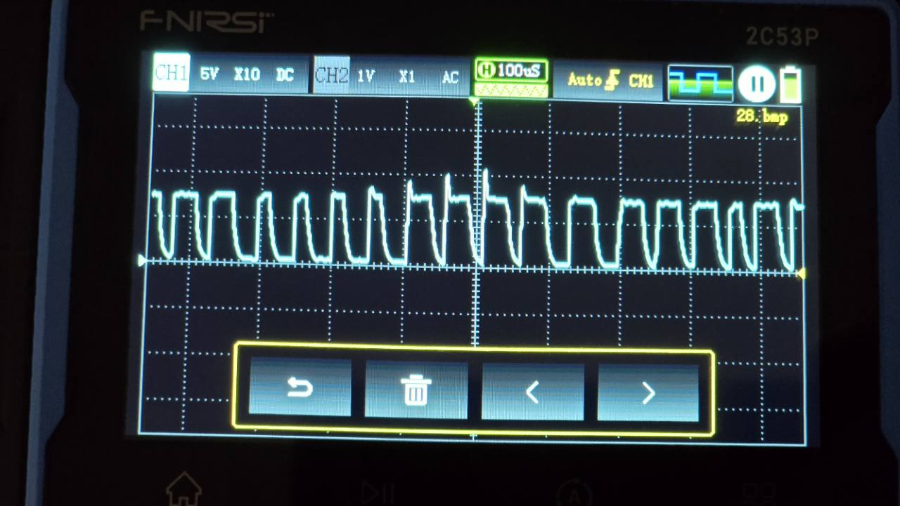

100 µs/div, screen `31.bmp`:

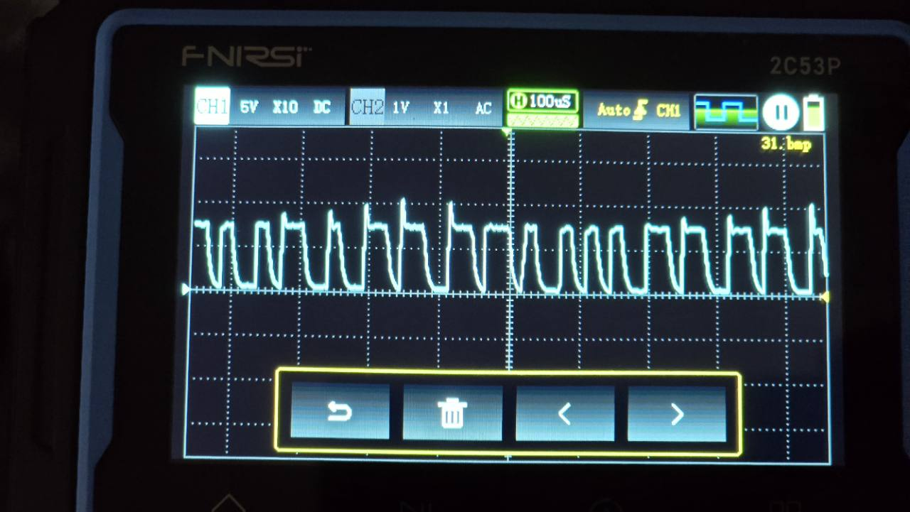

</details>

## Relevance to AL5 work and remaining evidence

These results support using the GT capture as a useful, explicitly incomplete research record of an E54 read. They do not establish an AL5 programming sequence, verify AL5 erase/block/finalization behavior, establish interrupted-flash recovery, or authorize enabling the AL5 writer.

The outstanding capture questions are the missing-short-ACK mechanism, independent complete-bus comparison, transition coverage and electrical behavior beyond these sampled windows. AL5 programming/readback/recovery and MultiMap runtime behavior require their own qualification. A successful ordinary E54 read cannot substitute for either.

This publication contains selected derived results and original photographs. The underlying CTZ/BIN files, HTX traces and serial logs remain private. Their selected evidence hashes are provided for provenance; hashes alone do not allow an external reviewer to reproduce the full packet comparison. No vehicle identifiers, tune payloads or local absolute paths are published here.
